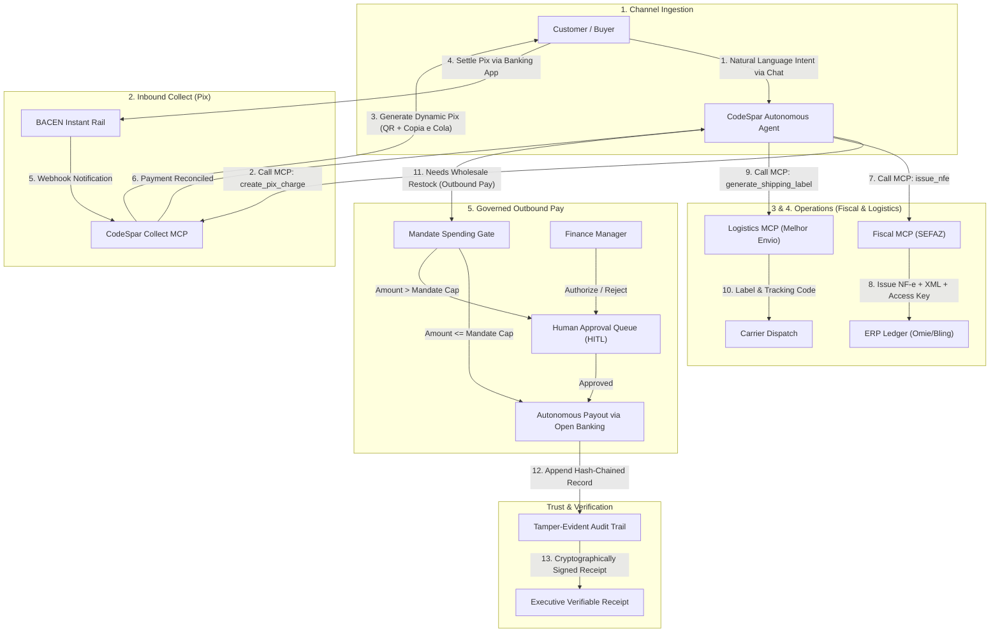
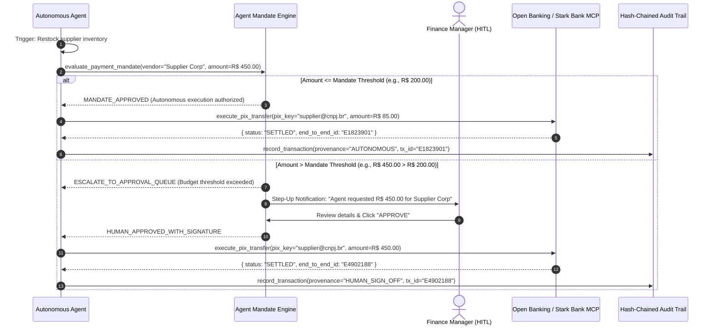
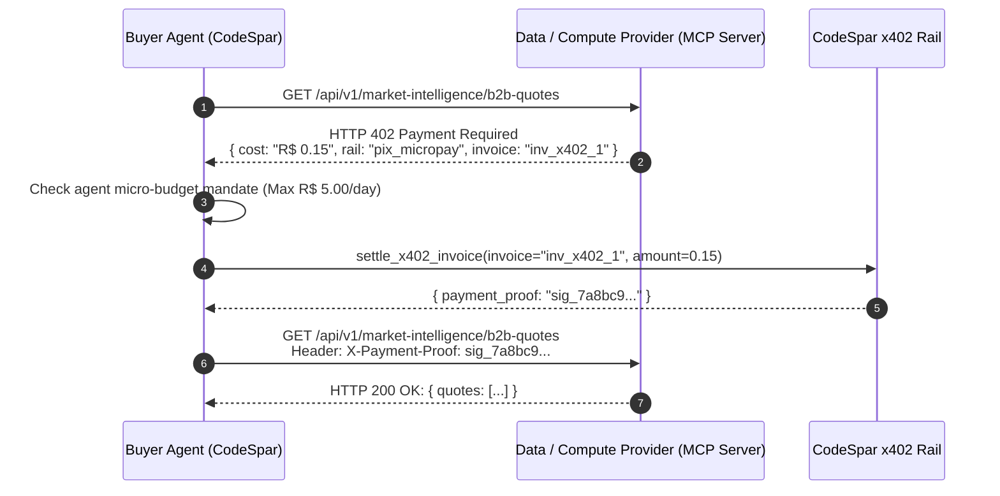
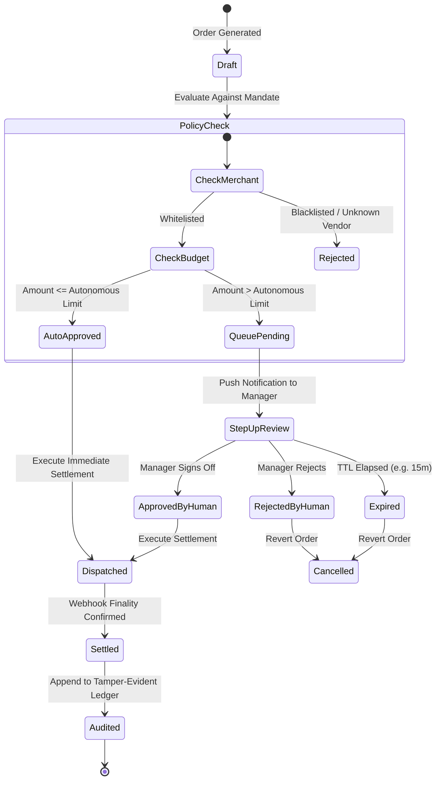

# CodeSpar Architectural Flows & Mermaid Sequence Diagrams

This document specifies the technical sequence and state diagrams for the CodeSpar Agentic Commerce proof-of-concept.

---

## 1. End-to-End 5-Pillar Commerce Flow

---

## 2. Inbound Collect & Fiscal Flow (Sequence Diagram)

```mermaid
sequenceDiagram
    autonumber
    actor Customer as Customer (WhatsApp/Web)
    participant Agent as CodeSpar Agent
    participant Collect as CodeSpar Collect MCP
    participant Pix as Central Bank / Pix Rail
    participant Fiscal as Fiscal MCP (SEFAZ)
    participant Shipping as Logistics MCP

    Customer->>Agent: "Order 2x Developer Kits to São Paulo"
    Agent->>Agent: Parse catalog, inventory, and calculate total (R$ 85.00)
    Agent->>Collect: create_charge(amount=85.00, rail="pix", currency="BRL")
    Collect-->>Agent: { charge_id: "ch_981", qr_code: "000201...", copy_paste: "pix.codespar.dev/pay/ch_981" }
    Agent-->>Customer: Present Pix QR Code & Copy-Paste string
    Customer->>Pix: Scan QR code and pay via mobile banking
    Pix-->>Collect: Webhook: PAYMENT_SETTLED (tx_id: "e902b1f", amount: 85.00)
    Collect-->>Agent: Event: charge.settled(ch_981)
    
    rect rgb(25, 45, 65)
        Note over Agent,Fiscal: Operational Fulfillment Tail
        Agent->>Fiscal: issue_nfe(buyer="Customer", value=85.00, items=[...])
        Fiscal-->>Agent: { nfe_key: "35261189020001...", status: "AUTHORIZED" }
        Agent->>Shipping: create_shipment(destination="SP", weight=1.2)
        Shipping-->>Agent: { tracking_number: "BR982104921", label_url: "https://..." }
    end

    Agent-->>Customer: "Payment confirmed! NF-e issued and tracking code is BR982104921"
```

---

## 3. Outbound Governed Pay & Approval Queue Flow

---

## 4. x402 Agent-to-Agent (A2A) Micropayment Flow

---

## 5. Dual-Mode Engine & Transparent Fallback Flow

```mermaid
sequenceDiagram
    autonumber
    participant App as Presentation Simulator / CLI
    participant Router as Engine Router
    participant Live as CodeSpar Live Sandbox API
    participant Fallback as High-Fidelity Fallback Simulator
    participant Output as Verifiable Receipt & UI Badge

    App->>Router: execute_transaction(payload)
    Router->>Live: Healthcheck & Ping Sandbox Endpoint
    
    alt Live Endpoint Healthy & Authorized
        Live-->>Router: HTTP 200 OK
        Router->>Live: Process Collect / Pay tools
        Live-->>Router: Result Payload
        Router->>Output: Emit Receipt with Badge: [CODESPAR_LIVE_SANDBOX]
    else Network Offline / API Unreachable / Sandbox Token Missing
        Live-->>Router: Connection Failed / Timeout
        Router->>Fallback: Divert to Deterministic Local Sandbox
        Fallback-->>Router: Simulated Sandbox Result Payload
        rect rgb(65, 25, 25)
            Note over Router,Output: Explicit Transparency Enforced (ADR-0001)
            Router->>Output: Emit Receipt with Conspicuous Badge:<br/>⚠️ [SANDBOX_FALLBACK_SIMULATOR]
        end
    end
```

---

## 6. State Machine: Agent Mandate & Approval Queue

